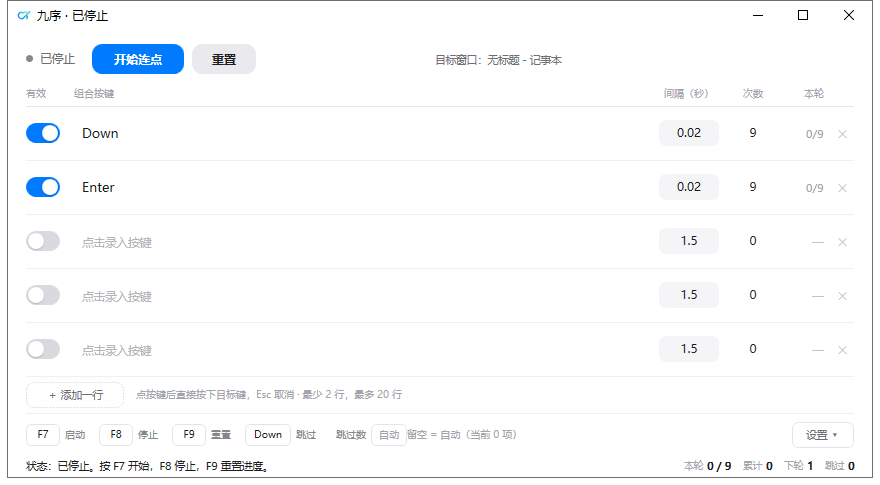

# 九序 / NineFlow

[](https://github.com/chaotools/NineFlow/actions/workflows/build.yml)
[](https://github.com/chaotools/NineFlow/releases/latest)
[](LICENSE)
[](#6-测试)
[](#1-功能)

> 徽章说明：`build` 来自 GitHub Actions，实时反映构建状态；`release` 由 shields.io 读取最新 Release，自动跟随版本；`license`、`tests`、`platform` 为静态徽章。

Windows 桌面「多键连发 · 智能续点」工具，免安装、双击即用，**关闭窗口后可在托盘后台常驻**。

- 中文名：**九序**
- 英文名：**NineFlow**

技术栈：C# / .NET 8 / WinForms。目标是让「重复按键 + 跨轮续点」这类工作一步完成，
同时把键盘发到正确的窗口，并把状态、进度说清楚。

---

## 1. 功能

- **10 行独立按键**：每行独立开关、按键、间隔（秒）、次数（0 = 无限）。
- **按键直接录**：点输入框右侧 ▾ 选「按下要用的键…」（或双击输入框），
  按下键盘上任意键即可，组合键也能录（`Ctrl+Shift+S` 会写成 `^+s`）；当然也可以自己填。
- **续点**：重开页面后按一次热键即可跳过已处理项继续，进度自动保存。
- **全局热键**：默认 F7 开始、F8 停止，可自行修改；运行中锁定编辑区。
- **托盘常驻**：点关闭只是缩到托盘，热键继续可用；双击托盘图标或再次双击 exe 唤回窗口。
- **目标窗口感知**：界面显示「目标窗口」，点「开始连点」时会自动把焦点交回目标窗口，
  不会把按键发给自己；找不到目标窗口会明确提示。
- **本次执行摘要**：一眼看清这次会执行哪些行、各发多少次、跳过几项、发到哪个窗口。
- **提示音 / 窗口置顶**：开始停止有声音反馈；可让窗口常在最前。
- 默认配置：`Down` / `Enter` 各 9 次、间隔 0.02 秒。

## 截图



---

## 2. 直接使用（exe）

见 `使用说明.md`。要点：

1. 双击 `九序.exe`（或英文名 `NineFlow.exe`）。
2. 点一下微信「分别发送给」页面，让它成为活动窗口。
3. 按 `F7` 开始；按 `F8` 停止；关闭窗口不退出，缩到托盘继续工作。

配置文件 `NineFlow.ini` 生成在 exe 同目录。

---

## 3. 从源码构建

需要 **.NET 8 SDK**。

```powershell
.\build.ps1               # 还原 + 编译 + 全部单元测试 + 发布单文件 exe
publish\NineFlow.exe      # 产物
```

参数：`-SkipTests` 跳过测试；`-NoPublish` 只编译测试。

在 VS Code 打开本目录即可（`.vscode\tasks.json` 提供 build / run / test / publish 任务，
`Ctrl+Shift+B` 直接编译）。

---

## 4. 项目结构

```
NineFlow\
├─ assets\                     图标
│  ├─ logo-mark.png            去背景 Logo（透明，界面头部使用）
│  ├─ app.ico                  9 种尺寸（16~256）Windows 图标
│  └─ logo-source-copy.png     原始图标存档
├─ src\
│  ├─ NineFlow.Core\           与界面无关的核心逻辑
│  │  ├─ SlotState.cs          单个按键槽位状态
│  │  ├─ AppDefaults.cs        出厂默认值
│  │  ├─ IniDocument.cs        INI 读写（保留未知键，UTF-8/UTF-16）
│  │  ├─ SettingsStore.cs      配置/进度持久化、界面选项
│  │  ├─ KeyNames.cs           按键名 → 虚拟键码
│  │  ├─ SendSpec.cs           组合按键文本解析
│  │  ├─ KeySender.cs          SendInput 真实按键发送
│  │  ├─ HotkeyDef.cs          全局热键解析
│  │  ├─ HotkeyRegistry.cs     RegisterHotKey 注册与 WM_HOTKEY 分发
│  │  ├─ ClickSession.cs       连点调度纯逻辑
│  │  ├─ ClickEngine.cs        后台线程 + 高精度计时 + 跳过 + 发送前回调
│  │  ├─ WindowsDesktop.cs     前台窗口 / 目标窗口工具
│  │  ├─ UiText.cs             界面文案
│  │  └─ TimePeriod.cs         timeBeginPeriod(1)
│  └─ NineFlow\                WinForms 界面（苹果风）
│     ├─ Program.cs            入口、单实例唤起、全局异常兜底
│     ├─ MainForm.cs           主窗口、托盘、热键、状态机
│     ├─ Controls.cs           自绘卡片 / 按钮 / 开关 / 输入框 / 顶栏
│     ├─ Theme.cs              配色、字体、圆角
│     └─ Assets.cs             内嵌图标与 Logo
├─ tests\
│  ├─ NineFlow.Tests\          299 项逻辑测试（控制台运行，无第三方框架）
│  └─ KeyCatcher\              测试辅助：全局键盘钩子记录按键
├─ tools\                      发布版 exe 的端到端测试与截图脚本
└─ build.ps1                   一键构建
```

---

## 5. 设计要点

**分层**：`NineFlow.Core` 不引用 WinForms，只含 P/Invoke 与纯逻辑，
因此可以在控制台里直接测试真实的全局热键注册与真实 SendInput 按键投递。
界面层只负责读写控件、调用引擎、合并刷新状态。

**调度精度**：`ClickEngine` 用独立线程调度，每个槽位维护自己的“下次到期时间”，
启动时调用 `timeBeginPeriod(1)` 提升系统计时精度；落后时不会补发爆发，
而是以当前时刻重新排期。

**按键发送**：`SendInput` 发送按下/释放事件，支持修饰键（Ctrl/Alt/Shift/Win）、
命名键（Down / Enter / F7 …）、字符（按当前键盘布局解析，无法映射时走 Unicode 注入）
与鼠标动作。

**全局热键**：`RegisterHotKey` + 窗口过程分发 `WM_HOTKEY`，注册失败会区分
“已被其它程序占用”和“其它错误”，并在界面上明确提示。

**托盘与单实例**：关闭窗口默认隐藏到托盘，热键与引擎继续工作；
用命名互斥量 + 命名事件实现单实例，第二次启动会把已有窗口唤到前台。

**目标窗口**：定时记录最近一个属于其它程序的前台窗口；真正发送前若发现前台是
九序自己的窗口（或它的提示框），会把焦点交回目标窗口再发按键，
避免“点了开始却发给自己的窗口”。

**配置**：自解析 INI，保留未知的节和键，兼容 UTF-8 / UTF-16（含 BOM），
写入采用临时文件 + 原子替换。

---

## 6. 测试

```powershell
dotnet build tests\NineFlow.Tests\NineFlow.Tests.csproj -c Release
dotnet tests\NineFlow.Tests\bin\Release\net8.0-windows\NineFlow.Tests.dll
```

- **331 项**单元 / 集成测试：INI 解析与往返、配置与界面选项、按键名映射、
  组合按键解析、热键解析、连点调度与引擎、真实 `RegisterHotKey` + `WM_HOTKEY`、
  真实 `SendInput` 投递、0.02 秒发送频率。
- **42 项**对发布版 exe 的端到端测试（`tools\e2e-v2.ps1`，UI 自动化驱动真实窗口 +
  全局键盘钩子统计按键）：
  - 名称与自动化元素、摘要文案
  - **只执行勾选的行**（勾选行发 3 次、未勾选行 0 次、无多余按键）
  - 关闭到托盘后进程常驻、隐藏状态下 F7 仍有效、二次启动唤出窗口
  - 窗口置顶开关真实生效
  - F7/F8 开始停止与进度保存
  - 关闭到托盘关闭时正常退出并保存进度
- **`tools\verify-delivery.ps1`**：交付目录自检（启动、自建 ini、工作目录无关性、单实例）。
- **CI**：推送到 `main` 时 GitHub Actions 在 Windows 上编译并运行 299 项逻辑测试（跳过需要真实桌面的 32 项集成测试），产物可在 Actions 页面下载。

---

## 7. 配置文件

`NineFlow.ini`（与 exe 同目录，UTF-8）：

```ini
[Slot1]
Enabled=1
Key=Down
Interval=0.02
MaxCount=9
Done=0

[Slot2]
Enabled=1
Key=Enter
Interval=0.02
MaxCount=9
Done=0

[Hotkey]
On=F7
Off=F8

[Skip]
Key=Down
Count=

[General]
CloseToTray=1
Beep=1
TopMost=0

[Progress]
LastSkip=0
SkipKey=Down
```

- `Count=` 为空表示自动取累计次数的最大值，可手填数字微调。
- `Done` 为累计次数，「重置进度」会清零。
- 未知的节和键会被保留。

---

## 8. 组合按键写法速查

| 写法 | 含义 |
|---|---|
| `Down` / `Enter` / `Space` / `F7` | 普通按键 |
| `a` / `2` | 单字符 |
| `^a` / `!q` / `+s` / `#r` | Ctrl+A / Alt+Q / Shift+S / Win+R |
| `^+{Tab}` | Ctrl+Shift+Tab |
| `Ctrl+A` / `Alt+F4` | 常见组合键写法 |
| `{Tab}{Tab}` / `Down,Enter` | 连续动作 |
| `LButton` / `RButton` / `WheelUp` | 鼠标动作 |

---

## 9. 已知限制

- 仅支持 Windows（WinForms + SendInput）。
- 只做「发送按键」，不做图像识别 / 窗口定位，需要用户先把目标窗口切到前台。
- 定时精度受系统调度影响；0.02 秒配置下实测频率符合预期。
- 未做代码签名，首次运行可能出现 SmartScreen 提示。

---

## 相关文档

- [更新日志](CHANGELOG.md)
- [参与贡献](CONTRIBUTING.md)
- [安全说明](SECURITY.md)
- [使用说明](使用说明.md)
